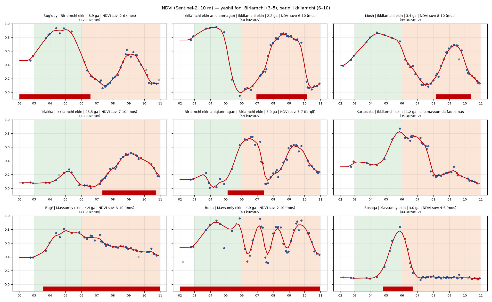

# polygon_holati

*(lokal papka: `ekin_fenologiya`)*

Har bir ekin konturi uchun **Sentinel-2 (10 m) indeks vaqt qatori** (NDVI, EVI2, NDMI) va undan
**mavsum bo'yicha faollik** (dala qachon tirik bo'lgan → `suv_boshi` / `suv_oxiri`) — ET (suv iste'moli)
hisobiga konturlarni mavsumlari ajratilgan holda tayyorlash uchun.

Ekin turi aniqlanmaydi — faqat dalaning o'z "ritmi" (fenologiyasi).
Kirish: `birlamchi_ikkilamchi` loyihasining natijasi (`uniqueid` bilan konturlar).

## Versiyalar (loyiha bosqichlari)

| Versiya | Repozitoriy | Nima qiladi | Natija |
|---|---|---|---|
| **v1** | GitHub [`fazogird/birlamchi_ikkilamchi`](https://github.com/fazogird/birlamchi_ikkilamchi) · GitLab `d.nozimov/birlamchi_ikkilamchi_mavsum` | Qishloq xo'jaligi konturlarini **tuzatish**: mavsum (Birlamchi / Ikkilamchi / Mavsumiy), to'liq dalani har mavsumda yopish, fermer ma'lumoti, `uniqueid`, qat'iy suv oylari (3–5 / 6–10 / 3–10) | `ekin_yerlar_toliq.gpkg`, `ekin_yerlar_qisqa.gpkg` |
| **v2** (shu repozitoriy) | GitHub [`fazogird/polygon_holati`](https://github.com/fazogird/polygon_holati) · GitLab `d.nozimov/dalaga_index_run` | v1 konturlariga **Sentinel-2 indeks** (NDVI, EVI2, NDMI) yozish va dalaning **o'z faol davrini** ajratish → har kontur uchun NDVI bo'yicha suv oylari | `qator_<tuman>.parquet`, `fenologiya_<tuman>.parquet` |
| **v3** (shu repozitoriy, 05) | — | NDVI kalendaridan kelishilgan **suv oylari** v1 qisqa fayliga: Birlamchi 3-4/3-5/3-6, Ikkilamchi undan keyin …-10, Mavsumiy 3-10; Ozuqa/Bug'doy ustidagi Paxta → Ikkilamchi. Geometriya va boshqa atributlar o'zgarmaydi | `ekin_yerlar_qisqa_v3_fenologiya.gpkg` |

v1 "qishloq yorlig'i qaysi mavsum deydi" savoliga, v2 esa "dala haqiqatan qachon faol bo'lgan" savoliga javob beradi —
yorliq xato bo'lsa ham suv to'g'ri oylarga yoziladi.

## Natija namunasi — Jomboy tumani (2026, fevral–oktyabr)



*Nuqtalar — Sentinel-2 NDVI (har 2–5 kunda, bulutsiz); qizil chiziq — silliq NDVI; pastdagi qizil tasma — kontur
mavsumi uchun topilgan faol davr. Fon: yashil — qat'iy Birlamchi oynasi (3–5), sariq — Ikkilamchi (6–10).*

Grafikdan ko'rinadi: bug'doy fevraldan yashil va iyunda o'riladi (NDVI bo'yicha 2–6); "Ikkilamchi" deb belgilangan
Kartoshka aslida may–iyulda faol (u davr ostidagi "Birlamchi aniqlanmagan" konturga yoziladi — suv ikki marta
sanalmaydi); "Boshqa" faqat may–iyunda faol; bog' va beda butun mavsum.

| Jomboy, 15 296 kontur | Qat'iy oylarga mos | Farqli | Shu mavsumda faol emas |
|---|---|---|---|
| Birlamchi | 3 323 | **859** | **801** |
| Ikkilamchi | 4 935 | 9 | 456 |
| Mavsumiy | 4 770 | 1 | 29 |

Eng ko'p uchraydigan NDVI oylari: Birlamchi **2–6** (qat'iy 3–5), Ikkilamchi **8–10 / 7–10** (qat'iy 6–10),
Mavsumiy 3–10. Usul — [qaror 0010](qarorlar/0010-fenologiya-mantiqi.md).

**Hisob hajmi (4 viloyat):** 70 tuman, 540 194 kontur, tuman boshiga 51–105 Sentinel-2 kuni; 4–6 parallel
terminalda bir kecha (batafsil — [jurnal](qarorlar/JURNAL.md), [yo'riqnoma](docs/ISHGA_TUSHIRISH.md)).

## Tamoyillar
- Konturlar **kompyuterdan chiqmaydi**: sun'iy yo'ldosh tasvirlari ochiq STAC/COG manbalardan oqim bilan o'qiladi,
  hisob lokal (yoki tashkilotning o'z AWS serverida).
- Manba konfiguratsiyada tanlanadi: `aws` (Earth Search, `sentinel-2-c1-l2a`) yoki `pc` (Planetary Computer).
- Natija `uniqueid` bo'yicha — asl konturlar bilan lokalda birlashtiriladi.

## Tuzilma
```
config/      sozlamalar.yaml — manba, sana oralig'i, indekslar, bulut chegarasi
src/fenologiya/  kutubxona: STAC qidiruv, o'qish, indekslar, zonal statistika, fenologiya
scripts/     pipeline qadamlari (00_ ... 0N_)
notebooks/   suv_oylari.ipynb — 05 qadamma-qadam (kernel: fenologiya, ipykernel kerak)
data/        kirish/ oraliq/ natija/   (gitga kirmaydi)
logs/        jurnallar                 (gitga kirmaydi)
tests/       testlar (test_indeks, test_bufer, test_fen)
qarorlar/    qabul qilingan qarorlar va jarayon jurnali
docs/        hujjat va rasmlar
env/         conda muhit tavsifi
run.bat      fenologiya muhitida skript ishga tushirish (activate shart emas)
dashboard.bat  interaktiv dashboard (scripts/dashboard.py, fenologiya_viz muhiti) -> http://localhost:8501
```

## Pipeline
| Qadam | Skript | Nima | Holat |
|---|---|---|---|
| 00 | `00_test_tezlik.py` | manbalar (AWS / PC) mavjudligi va o'qish tezligi | tayyor |
| 01 | `01_geom_tayyorlash.py` | konturlar → `uniqueid` + mavsum + geometriya (UTM 42N), ichki bufer **maydonga qarab** | tayyor |
| 02 | `02_stac_qidiruv.py` | davr bo'yicha Sentinel-2 sahnalari ro'yxati (bulut filtri) | tayyor |
| 03 | `03_indeks_qator.py` | har kontur × sana: NDVI, EVI2, NDMI, toza piksel soni | tayyor |
| 03b | `03b_grafik.py` | namunaviy konturlar NDVI grafiklari (tekshirish) | tayyor |
| 04 | `04_fenologiya.py` | silliqlash, faol sikllar, mavsum bo'yicha faol davr, `suv_boshi_ndvi`/`suv_oxiri_ndvi` | tayyor |
| 04b | `04b_mos_kelmaganlar.py` | qat'iy oylarga mos kelmagan (`farqli`, `faol_emas`) konturlar — GPKG (ArcGIS) + CSV (Excel) | tayyor |
| 04c | `04c_kalendar.py` | NDVI ekin kalendari: viloyat × ekin turi × mavsum | tayyor |
| 04d | `04d_zona_kalendar.py` | zona kalendari (`config/zonalar.yaml`): zona × mavsum × ekin, hozirgi va taklif oylar → Excel | tayyor |
| 05 | `05_suv_oylari.py` | **v3**: `ekin_yerlar_qisqa.gpkg` → `..._v3_fenologiya.gpkg` — faqat `suv_boshi`/`suv_oxiri` (va Ozuqa/Bug'doy ustidagi Paxta `season` → Ikkilamchi); qoidalar `config/suv_oylari.yaml`, [qaror 0012](qarorlar/0012-zona-kalendari-va-suv-oylari.md) | tayyor |
| — | `notebooks/suv_oylari.ipynb` | 05 qadamma-qadam + tekshiruv + Birlamchi/Ikkilamchi chegarasi bir xil / farqli soni | tayyor |

## Dashboard — natijani ko'rish (Excel o'rniga)

Tuman xaritasi + konturni bosganda uning NDVI / EVI2 / NDMI vaqt qatori. Bepul (Streamlit + DuckDB + pydeck),
kompyuterning o'zida ishlaydi; parquet'dan faqat kerakli qism o'qiladi, shuning uchun millionlab qatorda ham tez.
Bir marta muhit yaratiladi (pipeline muhitidan alohida):
```
conda env create -f env\environment_viz.yml
```
Ishga tushirish → brauzerda http://localhost:8501 (to'xtatish: terminalda `Ctrl+C`):
```
.\dashboard.bat
```
- **Xarita va kontur:** viloyat / tuman tanlanadi; rang — tanlangan sanadagi NDVI/EVI2/NDMI (sana slayderi),
  maksimal NDVI, toza kuzatuvlar soni, ekin turi, mavsum, 04 bo'lsa yorliq mosligi / faol kunlar / sikl soni /
  cho'qqi oyi. Filtr: ekin turi, mavsum, yorliq, maydon. Fon: oddiy yoki sun'iy yo'ldosh (Esri).
  Konturni bosing → o'ngda vaqt qatori (nuqta — toza kun, x — bulutli; silliq NDVI va 04 faol oraliq tasmasi),
  fenologiya kartochkasi, CSV yuklab olish. **Solishtirish** yoqilsa bosilgan konturlar ustma-ust (8 tagacha).
  uniqueid bo'yicha qidiruv konturga yaqinlashtiradi.
- **Tuman bo'yicha:** ekin turi / mavsum / yorliq guruhlari bo'yicha median indeks egri chiziqlari, jadvallar,
  Sentinel-2 kunlarining toza ulushi.
- **Barcha tumanlar:** kontur soni, indeks yozuvlari, 04 bor-yo'qligi va mos/farqli/faol_emas soni.

Havola bilan aniq tumanni ochish: `http://localhost:8501/?tuman=jomboy_tumani`. Pipeline yangi tuman yozsa —
chap paneldagi **↻ Fayllarni qayta o'qish**. Usul va muqobillar (Superset, Kepler.gl, QGIS) — [qaror 0011](qarorlar/0011-dashboard.md).

Qarorlar va jarayon jurnali: **[qarorlar/](qarorlar/README.md)** · To'liq ishga tushirish yo'riqnomasi: **[docs/ISHGA_TUSHIRISH.md](docs/ISHGA_TUSHIRISH.md)**.

## Muhitni yoqish (uchta yo'l)

**A. Eng oson — `run.bat`** (conda sozlanmagan bo'lsa ham ishlaydi; VS Code PowerShell yoki cmd da):
```
cd D:\Tasks\ekin_fenologiya
.\run.bat scripts\01_geom_tayyorlash.py --tuman "Jomboy tumani"
```
Quyidagi buyruqlarda `python` o'rniga `.\run.bat` yozing.

**B. Doimiy — PowerShell uchun conda ni bir marta sozlash** (`conda` "не распознано" xatosi chiqsa):
```
& "$env:LOCALAPPDATA\miniconda3\Scripts\conda.exe" init powershell
```
Terminalni yopib qayta oching. "Выполнение сценариев отключено" xatosi chiqsa, bir marta:
```
Set-ExecutionPolicy -Scope CurrentUser RemoteSigned
```
Keyin `conda activate fenologiya` ishlaydi.

**C. VS Code** — `Ctrl+Shift+P` → *Python: Select Interpreter* → `fenologiya`; yangi ochilgan terminal muhitni o'zi yoqadi.

## Ko'p tuman: `pipeline.py` (tavsiya etiladi)

Har tuman uchun 01 → 02 → 03 ni ketma-ket bajaradi. **Davom ettiradi**: natija fayli bor qadam o'tkazib yuboriladi —
run to'xtasa (internet, kompyuter o'chsa), xuddi shu buyruqni qayta bering. Bir tuman xato bersa keyingisiga o'tadi,
oxirida xulosa chiqaradi. Jurnal: `logs\pipeline_*.log`, holat: `logs\holat.csv`.
```
.\run.bat pipeline.py royxat                                   # barcha tumanlar, holati, taxminiy vaqt
.\run.bat pipeline.py royxat --viloyat "Samarqand viloyati"
.\run.bat pipeline.py indeks --viloyat "Samarqand viloyati"    # butun viloyat
.\run.bat pipeline.py indeks --tuman "Urgut tumani" "Tayloq tumani"
.\run.bat pipeline.py indeks --hammasi                         # hamma tuman (bir necha o'n soat)
```
`--ishchi N` — parallel oqimlar (standart 6), `--qayta` — bor natijalarni ham qaytadan hisoblash.
Tavsiya: viloyatma-viloyat, kechasi yoki dam olish kunlari ishga tushiring. 4 viloyatni 4 ta terminalda parallel
ishlatish mumkin (katta viloyatlarga `--ishchi 4` — xotira uchun); kompyuter uxlab qolmasin.

**04 — fenologiya** (03 tayyor tumanlar uchun, tuman boshiga bir necha soniya):
```
.\run.bat pipeline.py fenologiya --hammasi
.\run.bat scripts\03b_grafik.py --tuman "Jomboy tumani"         # tekshirish grafiklari (silliq chiziq + faol oraliq)
```
Natija: `data\natija\fenologiya_<tuman>.parquet` — har kontur: `faol`, `boshi_sana`, `oxiri_sana`, `suv_boshi_ndvi`,
`suv_oxiri_ndvi`, `yorliq_mos`, `ishonch` va boshq. (qaror 0010).

## Ishga tushirish tartibi (bitta tuman, qadamma-qadam)

Muhit yoqilgan terminalda (yoki `python` o'rniga `.\run.bat`):
```
cd D:\Tasks\ekin_fenologiya
```
1. Tekshiruvlar (bir necha soniya):
```
python tests\test_indeks.py
python tests\test_bufer.py
```
2. Konturlarni tayyorlash (~30 s) → `data\kirish\konturlar_jomboy_tumani.gpkg`
```
python scripts\01_geom_tayyorlash.py --tuman "Jomboy tumani"
```
3. Sahnalarni qidirish (~5 s) → `data\oraliq\sahnalar_jomboy_tumani.json`
```
python scripts\02_stac_qidiruv.py --tuman "Jomboy tumani"
```
4. Indeks vaqt qatori (Jomboy, fevral–oktyabr: ~15 daqiqa) → `data\oraliq\qator_jomboy_tumani.parquet`
```
python scripts\03_indeks_qator.py --tuman "Jomboy tumani" --ishchi 6
```
Har qadam o'z oraliq faylini qaytadan yozadi. Davr, bulut chegarasi, bufer — `config\sozlamalar.yaml` da.
`--ishchi` — parallel o'qish oqimlari (internet sekin bo'lsa kamaytiring).
Bir nechta tuman: `01` ga `--tuman "A tumani" "B tumani"` yoki `--hammasi`; `02` va `03` har tuman uchun alohida.

## Manba tanlovi — tezlik testi (2026-11-05, ishxona PC, Jomboy bo'lagi ~6 mln piksel)

| | AWS Earth Search | Planetary Computer |
|---|---|---|
| STAC qidiruv | ~1 s | ~1.6 s |
| 10 m kanal (qizil) | **5–7.5 s** | 11–16.5 s |
| 20 m kanal (SCL) | 0.8–1.9 s | 0.4–0.5 s |

Ma'lumotning asosiy hajmi 10 m kanallar → **AWS ~2 baravar tez**; asosiy manba `aws`. Bitta oqim bilan o'lchangan,
parallel o'qishda tezlik oshadi. Jurnallar: `logs/test_tezlik_*.json`.

Eslatma: `gis_pro` muhitida numpy DLL nosozligi bor (matplotlib va `rasterio.windows.from_bounds` da
`0xc06d007f`) — shuning uchun bu loyiha alohida `fenologiya` muhitida ishlaydi.

## Muhit
```
conda env create -f env/environment.yml
conda activate fenologiya
```
