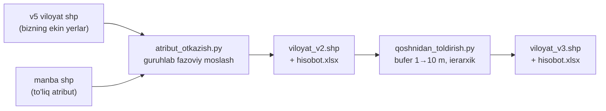
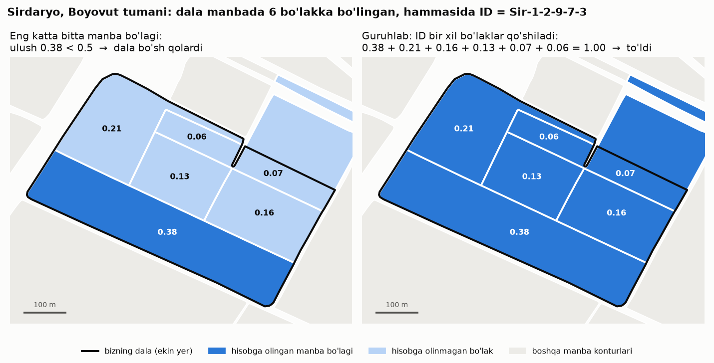
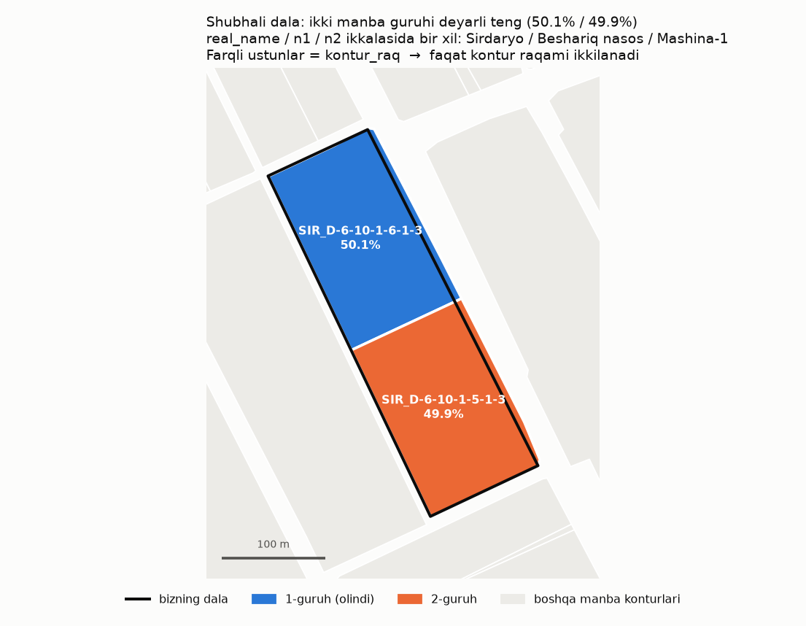
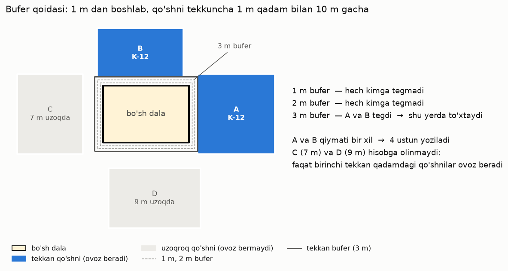
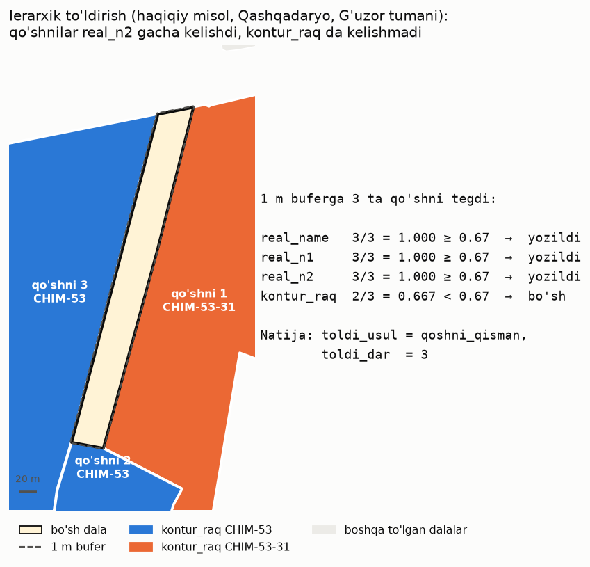
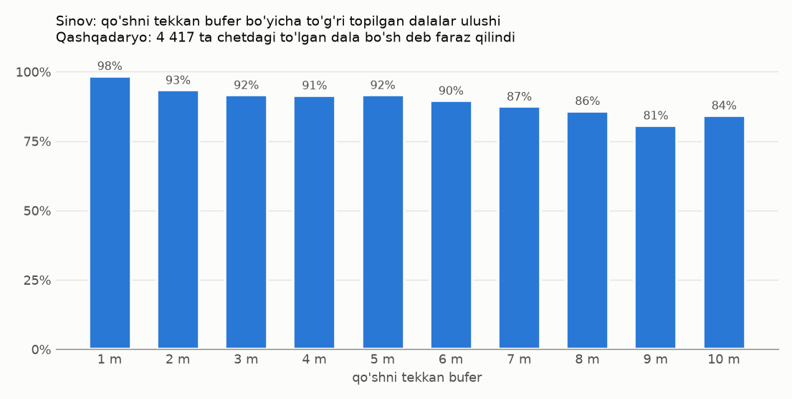

# viloyat_shp — ekin yerlariga nomenklatura va fermer ma'lumotini o'tkazish

Viloyat shp fayllari bilan ishlash (har bir viloyat alohida). Ikki skript bor:

| Skript | Nima qiladi |
|---|---|
| [`atribut_otkazish.py`](atribut_otkazish.py) | to'liq atributli **manba** shp dan bizning ekin yerlariga `kontur_raq`, `real_name`, `real_n1`, `real_n2` va fermer nomini fazoviy moslab o'tkazadi |
| [`qoshnidan_toldirish.py`](qoshnidan_toldirish.py) | manbaga tegmagani uchun **bo'sh qolgan** ekin yerlarini yonidagi to'lgan dalalardan to'ldiradi |

Ikkalasi ham kirish fayllarini o'zgartirmaydi (fayl xeshi bilan tekshiriladi), natijani yangi shp
ga va Excel hisobotga yozadi. Bu papka loyihaning boshqa modullariga (`src`, `scripts`, `eksport`,
`zonal`) ta'sir qilmaydi.

## Ish tartibi



Har skriptda kirish/chiqish fayl boshidagi **FOYDALANUVCHI SOZLAMALARI** blokida qo'lda yoziladi,
keyin loyiha ildizidan ishga tushiriladi:

```bash
.\run.bat viloyat_shp\atribut_otkazish.py
.\run.bat viloyat_shp\qoshnidan_toldirish.py
```

### Natijalar qisqacha (2026-11)

| Viloyat | Jami ekin yer | Manbadan to'ldi | Qo'shnidan to'ldi | Bo'sh qoldi |
|---|---|---|---|---|
| Sirdaryo | 42 876 | 42 679 (99.5%) | — | 197 |
| Farg'ona | 117 710 | 117 165 (99.5%) | — | 545 |
| Qashqadaryo | 180 338 | 163 500 (90.7%) | 7 941 (to'liq 7 892, qisman 49) | 8 897 |

---

## 1-qadam. `atribut_otkazish.py` — manbadan o'tkazish

### Sozlamalar

| O'zgaruvchi | Ma'nosi |
|---|---|
| `KIRISH` | ma'lumot qabul qiladigan viloyat shp (o'zgarmaydi) |
| `MANBA` | to'liq atributli shp (faqat o'qiladi, o'zgarmaydi) |
| `CHIQISH` | natija shp (yangi fayl) |
| `HISOBOT` | Excel hisobot; `None` — `CHIQISH` yonida `<nomi>_hisobot.xlsx` |
| `USTUNLAR` | `{manbadagi nomi: bizdagi nomi}`. Sirdaryo manbasida `ID → kontur_raq`, `LVL_0_name → real_name`, `LVL_1_name → real_n1`, `LVL_2_name → real_n2`; Farg'ona / Qashqadaryo manbasida nomlar bir xil (`kontur_raq → kontur_raq`, …) |
| `FERMER_BIZDA` / `FERMER_MANBADA` | bizdagi bo'sh `full_name` manbadagi fermer nomidan to'ldiriladi (`fermer_nom` yoki `full_name`) |
| `MIN_ULUSH` | moslik chegarasi (standart 0.5) |
| `ULUSH_USTUNI` | moslik ulushi ustuni (`mos_ulush`), kerak bo'lmasa `None` |
| `USTIGA_YOZ` | natija bor bo'lsa ustiga yozilsinmi |

### Mos ekin yerga mos ma'lumot qanday o'tkaziladi

Ikki faylda umumiy kalit ustun yo'q, proyeksiyalari ham har xil bo'lishi mumkin (bizniki
EPSG:3857, manbaniki UTM 42N). Shuning uchun konturlar **joylashuvi bo'yicha** (fazoviy) moslanadi.

**Muammo:** bizdagi bitta dala manbada ko'pincha bir nechta kichik konturga bo'lingan, lekin
ularning nomenklaturasi bir xil — nomenklatura bitta dala ichida o'zgarmaydi. Eng katta bitta
manba konturini olsak, har bo'lak dalaning 50% idan kam bo'lib, dala bo'sh qolardi.



1. **Guruhlab moslash.** O'tkaziladigan qiymatlari bir xil manba konturlari bitta guruh. Har
   bizning dala uchun har guruhning birlashgan kesishmasi hisoblanadi va eng katta ulushli guruh
   olinadi. Bir-birini qoplagan manba konturlari ikki marta sanalmaydi.
   - **Nomenklatura** — `kontur_raq + real_name + real_n1 + real_n2` to'rttasi birga, bitta
     guruhdan olinadi: biri bir bo'lakdan, boshqasi boshqa bo'lakdan aralashib ketmaydi.
   - **Fermer nomi** — alohida, fermer nomi qiymati bo'yicha guruhlanadi (bitta nomenklatura
     ichida fermer har xil bo'lishi mumkin). Faqat bo'sh `full_name` to'ldiriladi, bor qiymat
     o'zgarmaydi.
2. **Xavfsizlik chegarasi.** Guruh kesishmasi dala maydonining kamida 50% i bo'lishi shart
   (`MIN_ULUSH = 0.5`). Kam bo'lsa — hech narsa o'tkazilmaydi, boshqa konturning ma'lumoti
   adashib tushmaydi.
3. **Teng nomzodlar.** Ikki guruh teng bo'lsa, natija har safar bir xil: manbadagi qator tartibi
   bo'yicha birinchisi olinadi.
4. **`mos_ulush` ustuni** — har dalaga nomenklatura guruhining ulushi (0–1). QGIS/ArcGIS da
   `mos_ulush < 0.9` ni filtrlab, chegaradagi dalalarni ko'rish mumkin.
5. **O'zgarmaslik tekshiruvi.** Skript boshida va oxirida MANBA va KIRISH fayllarining xeshini
   solishtiradi; natijaning geometriyasi, CRS i va kontur soni kirish bilan bir xilligini tekshiradi.

### Shubhali dala nimani bildiradi

Dala manbadagi ikki konturning o'rtasida yotsa va ikkala guruh ulushi deyarli teng bo'lsa
(2-guruh ≥ 90% × 1-guruh), skript kattasini oladi va dalani hisobotning **Shubhali** varag'iga
yozadi. **Farqli ustunlar** qaysi qiymat aniq emasligini ko'rsatadi:



- **faqat `kontur_raq`** — `real_name`, `real_n1`, `real_n2` ikkala guruhda bir xil, ular aniq;
  faqat qaysi kontur raqami yozilgani ikkilanadi.
- **`kontur_raq` + `real_*`** — nomenklatura darajasi ham har xil: shularni xaritada ko'rib chiqing.

Farg'ona misoli: 22 nomenklatura shubhalisidan 16 tasi faqat `kontur_raq`, 3 tasi
`kontur_raq, real_n2`, 3 tasi `kontur_raq, real_n1, real_n2`.

### Excel hisobot

| Varaq | Nima bor |
|---|---|
| **Umumiy** | fayllar; CRS lar (KIRISH, MANBA, moslash qaysi CRS da, CHIQISH); ekin yerlar soni va maydoni (ga) — KIRISH va CHIQISH da; ma'lumot o'tgan / bo'sh qolganlar soni va maydoni; shubhalilar farqli ustunlar bo'yicha; tekshiruv |
| **Ustunlar** | qaysi ustundan qaysi ustunga: avval bo'sh edi, to'ldirildi, bo'sh qoldi, avvaldan bor (o'zgarmadi), foizlar |
| **Moslik** | moslik ulushi oraliqlari (≥ 0.99, 0.90–0.99, …, kesishma yo'q) bo'yicha konturlar soni; nechtasi bir nechta bo'lakdan yig'ilgan |
| **Tumanlar** | har tuman: kontur soni va maydoni, mos topilgan / bo'sh qolgan, `full_name` to'ldirilishi |
| **Bo'sh qolganlar** | ma'lumot o'tmagan dalalar (FID, unique_id, tuman, maydon, sabab) |
| **Shubhali** | deyarli teng ikki guruhli dalalar: farqli ustunlar, olingan va 2-guruh qiymatlari yonma-yon |

### Misol: Sirdaryo

| Ko'rsatkich | Eng katta bitta kontur | Guruhlab |
|---|---|---|
| Ma'lumot o'tdi | 42 523 | **42 679** (366 808.86 ga) |
| — shundan bir nechta manba bo'lagidan yig'ilgan | — | 3 863 |
| Bo'sh qoldi | 353 (3 608.85 ga) | **197** (1 025.15 ga) |
| `full_name` to'ldirildi (26 040 bo'shdan) | 20 264 | **20 336** |
| Avval o'tgan qiymatlardan o'zgargani | — | 0 |

Mustaqil tekshiruv: har dala ichidan nuqta olinib, u tushgan manba konturi bilan solishtirildi —
41 068 tadan 41 067 tasida qiymatlar aynan mos (1 tasida nuqta chegaraga tushgan).

---

## 2-qadam. `qoshnidan_toldirish.py` — qo'shnidan to'ldirish

Manbaga tegmagan yoki 50% ga yetmagan (ya'ni `real_name`, `real_n1`, `real_n2`, `kontur_raq`
**hammasi bo'sh**) dalalarga yonidagi to'lgan dalalardan qiymat beradi. Manbadan to'lgan dalalar
o'zgarmaydi.

### Sozlamalar

| O'zgaruvchi | Ma'nosi |
|---|---|
| `KIRISH` | 1-qadam natijasi (`viloyat_v2.shp`), o'zgarmaydi |
| `CHIQISH` | natija shp (yangi fayl) |
| `HISOBOT` | Excel hisobot; `None` — `CHIQISH` yonida `<nomi>_hisobot.xlsx` |
| `USTUNLAR` | to'ldiriladigan ustunlar, **yirikdan maydaga**: `real_name, real_n1, real_n2, kontur_raq` |
| `KELISHUV` | ierarxik to'ldirish chegarasi (standart 0.67) |
| `QADAM_M` / `MAX_M` | bufer qadami va eng katta masofa (1 m / 10 m) |
| `TEKSHIRUV_SONI` | sinov uchun nechta dala (5000; 0 — sinov yo'q) |
| `USTIGA_YOZ` | natija bor bo'lsa ustiga yozilsinmi |

### Bufer qoidasi



1. Bo'sh dalaga 1 m bufer beriladi. To'lgan dalaga tegsa — shu qadamda to'xtaydi; tegmasa 2 m,
   3 m, … 10 m gacha oshiriladi. Faqat birinchi tekkan qadamdagi qo'shnilar "ovoz beradi".
2. Bitta qo'shni tegsa — uning qiymatlari olinadi; bir nechta tegsa — eng ko'p takrorlangani.
   Teng bo'lsa — bufer ichida maydoni kattasi, keyin eng yaqini.
3. **Zanjir yo'q:** faqat avvaldan to'lgan dalalar qo'shni bo'ladi — yangi to'ldirilgan dala
   boshqasiga manba bo'lmaydi, xato tarqalmaydi.
4. **Haqiqiy metr:** hisob UTM da. KIRISH EPSG:3857 da bo'lsa ham — 3857 da "1 m" Qashqadaryoda
   taxminan 0.78 m bo'lar edi.

### Ierarxik to'ldirish

Qo'shnilar har xil bo'lsa, hamma ustunni ko'pchilikdan olish xavfli (sinovda faqat 51% to'g'ri).
Shuning uchun har daraja alohida tekshiriladi: `real_name → real_n1 → real_n2 → kontur_raq`.
Qo'shnilar **`KELISHUV` ulushida** kelishgan eng chuqur darajagacha yoziladi, undan maydaroq
ustunlar bo'sh qoladi.



`KELISHUV = 0.67` — daraja qiymati qo'shnilarning kamida 0.67 qismida bo'lishi shart:
3 qo'shnidan 2 tasi (0.667) **yetmaydi**, 4 tadan 3 tasi (0.75) yetadi. `1.0` — hamma qo'shni
kelishsin; `0` — ierarxiyasiz (doim to'liq, eng ko'p takrorlangani).

### Natijadagi yangi ustunlar

| Ustun | Ma'nosi |
|---|---|
| `toldi_usul` | `manba` — 1-qadamdan; `qoshni` — qo'shnidan to'liq; `qoshni_qisman` — faqat yirik darajalar; `kelishmadi` — qo'shnilar `real_name` da ham kelishmadi; `bosh` — 10 m ichida qo'shni yo'q |
| `toldi_dar` | nechta ustun to'ldi (0–4): 1 = `real_name`, 2 = `+real_n1`, 3 = `+real_n2`, 4 = hammasi |
| `qoshni_m` | qo'shni necha metrlik buferda topildi (1–10) |
| `qoshni_n` | shu buferga tekkan to'lgan qo'shnilar soni |
| `qoshni_ul` | yozilgan eng chuqur daraja qiymati qo'shnilarning qancha qismida (0–1) |

### Sinov: qanchalik ishonish mumkin

To'lgan, lekin **chetdagi** dalalar (yonida 10 m ichida bo'sh dala bor) bo'sh deb faraz qilinadi,
shu qoida bilan qiymat topiladi va haqiqiysi bilan solishtiriladi. Natija hisobotning **Sinov** va
**Qadamlar** varaqlarida — har viloyat uchun alohida.



`KELISHUV` ni tanlash (Qashqadaryo, 4 417 sinov dalasi):

| `KELISHUV` | Hammasi to'g'ri | Qo'shnilari har xil 79 dala: to'liq / qisman / bo'sh | Ulardan to'g'ri |
|---|---|---|---|
| 0 (ierarxiyasiz) | 93.9% | 79 / 0 / 0 | 50.6% |
| **0.67 (standart)** | **94.7%** | 5 / 41 / 33 | **100%** |
| 1.0 | 94.7% | 0 / 43 / 36 | 100% |

### Excel hisobot

| Varaq | Nima bor |
|---|---|
| **Umumiy** | fayllar, CRS, qoida; avval to'lgan / avval bo'sh / to'liq / qisman (necha ustun) / bo'sh qoldi (soni va maydoni); sinov aniqligi; tekshiruv |
| **Qadamlar** | har bufer (1–10 m): qo'shni topildi, to'liq, qisman, kelishmadi, maydoni, sinovda to'g'ri % |
| **Tumanlar** | har tuman: avval bo'sh, to'liq, qisman, bo'sh qoldi (soni va maydoni) |
| **To'ldirilganlar** | har dala: `toldi_usul`, to'ldirilgan ustunlar, bufer, masofa, qo'shnilar soni, bir xil / har xil, yozilgan qiymat va ulushi, to'liq eng ko'pi va 2-nomzod |
| **Bo'sh qolganlar** | sababi bilan: 10 m ichida qo'shni yo'q yoki qo'shnilar kelishmadi |
| **Sinov** | aniqlik bufer bo'yicha va qo'shnilar bir xil / har xil bo'yicha, har ustun alohida |

### Misol: Qashqadaryo

`qashqadaryo_viloyati_v2.shp` → `qashqadaryo_viloyati_v3_ierarxik.shp` (`KELISHUV = 0.67`)

| `toldi_usul` | Soni | Izoh |
|---|---|---|
| `manba` | 163 500 | 1-qadamdan, o'zgarmadi |
| `qoshni` | 7 892 | 4 ustun |
| `qoshni_qisman` | 49 | `real_name` 5; `+real_n1` 7; `+real_n2` 37 |
| `kelishmadi` | 56 | qo'shnilar `real_name` da ham kelishmadi |
| `bosh` | 8 841 | 10 m ichida qo'shni yo'q; eng yaqin to'lgan dalagacha mediana 73 m |

Bo'sh dalalarning ikkala turi ham olinadi: manbaga umuman tegmaganlar (13 479 → 4 956 to'ldi) va
manbaga tekkan-u 50% ga yetmaganlar (3 359 → 2 985 to'ldi).

### Ishchilar uchun: nimani avval ko'rib chiqish kerak

1. `toldi_usul = kelishmadi` va `qoshni_qisman` — qo'shnilar kelishmagan joylar.
2. `qoshni_m >= 8` — uzoqdan topilgan (sinovda 81–86% to'g'ri).
3. `toldi_usul = bosh` — qo'lda to'ldirish kerak (yaqinida to'lgan dala yo'q).

---

## Eslatmalar

- 10 m dan oshirish tavsiya qilinmaydi: aniqlik 9–10 m da ~80–84% ga tushadi, qolgan bo'sh
  dalalar esa o'rtacha 73 m uzoqda.
- 1-qadam hisobotidagi "Geometriya maydoni" manba EPSG:3857 da bo'lsa (Qashqadaryo) 3857
  birligida hisoblanadi va oshib chiqadi; moslash natijasiga ta'sir qilmaydi (ulushlar nisbiy),
  haqiqiy maydon uchun `maydon` ustuniga qarang.
- Rasmlar haqiqiy misollardan: Sirdaryo (Boyovut), Farg'ona (Beshariq), Qashqadaryo (G'uzor);
  fermer ismlari ko'rsatilmagan.
